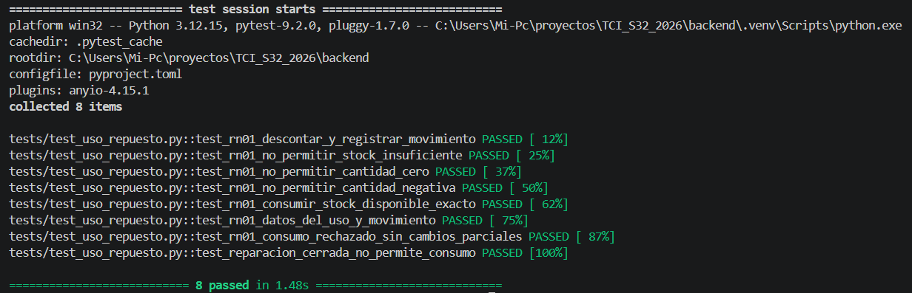
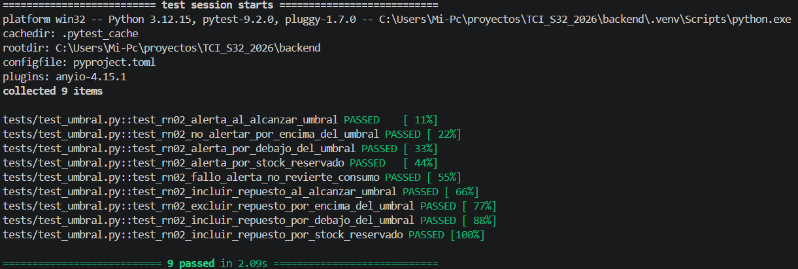
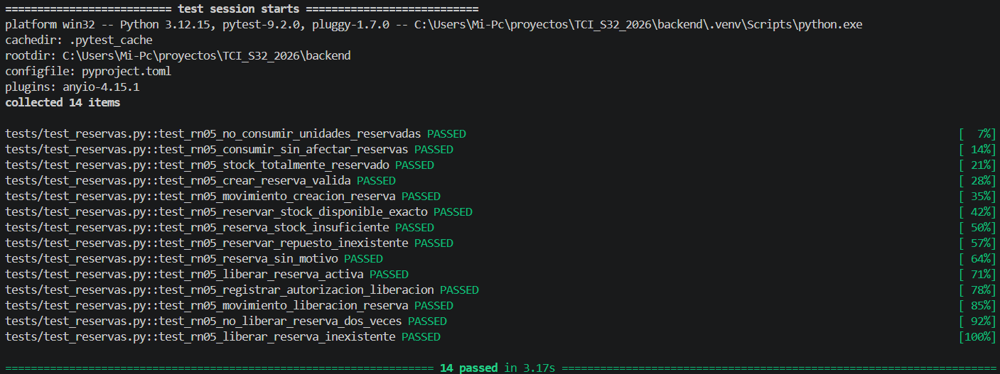
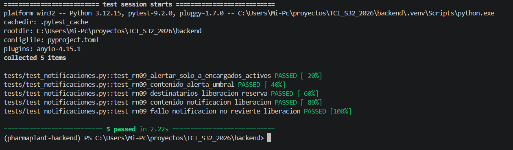
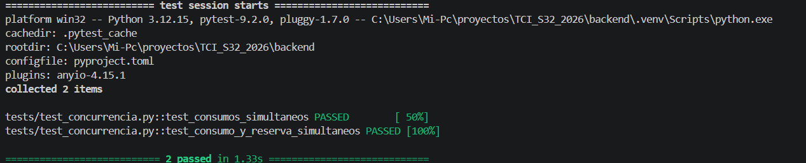
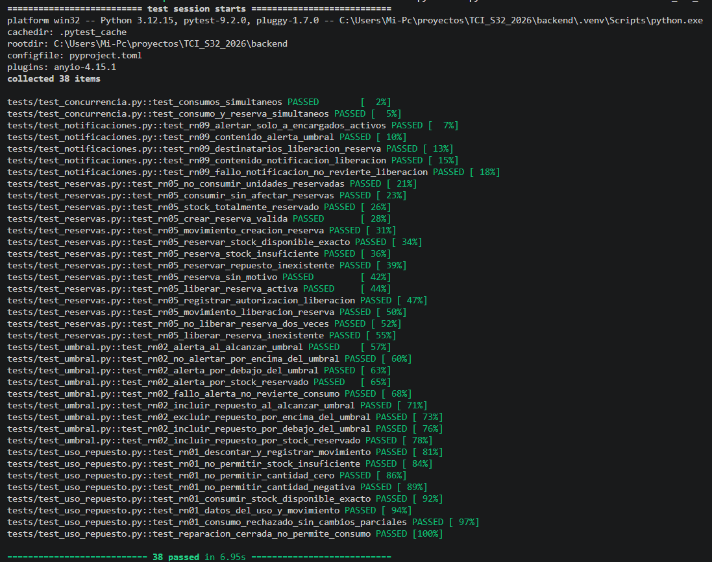

# Evidencias de pruebas de reglas de negocio
## 1. Objetivo
Verificar el cumplimiento de las reglas de negocio relacionadas con la gestión de stock, el consumo de repuestos, las reservas y las notificaciones de PharmaPlant CORE.
Además, se verifica la consistencia del inventario ante operaciones concurrentes sobre un mismo repuesto.

## 2. Entorno de pruebas
Las pruebas fueron desarrolladas utilizando:
- Python.
- Pytest.
- SQLModel.
- PostgreSQL.
- Docker.
- Alembic.
Se utiliza una base de datos independiente denominada `pharmaplant_test`, evitando modificar los datos de la base de datos principal del sistema.
Las pruebas utilizan fixtures para preparar los datos necesarios y garantizar su aislamiento.
Las pruebas convencionales utilizan transacciones con rollback, mientras que las pruebas de concurrencia utilizan sesiones independientes y eliminan los datos generados al finalizar.

## 3. Organización de las pruebas
Los archivos se encuentran dentro de `backend/tests/`.
| Archivo | Alcance | Cantidad |
|---|---|---:|
| test_uso_repuesto.py | RN-01 y validación del estado de reparación | 8 |
| test_umbral.py | RN-02 | 9 |
| test_reservas.py | RN-05 | 14 |
| test_notificaciones.py | RN-09 | 5 |
| test_concurrencia.py | RN-01 y RN-05 | 2 |
| **Total** | | **38** |
El archivo `conftest.py` contiene las fixtures compartidas por las pruebas.

## 4. Reglas de negocio verificadas
### RN-01. Consumo de repuestos
- Descuento correcto del stock físico.
- Validación de cantidades positivas.
- Rechazo de consumos con stock insuficiente.
- Consumo de la totalidad del stock disponible.
- Registro del consumo y del movimiento de salida.
- Conservación de los datos ante operaciones rechazadas.

### RN-02. Umbral mínimo de stock
- Identificación de repuestos por debajo del umbral mínimo.
- Identificación de repuestos con stock igual al umbral.
- Verificación de repuestos por encima del umbral.
- Consideración del stock reservado.
- Generación de alertas.
- Inclusión de repuestos en la lista de compras.
- Conservación del consumo ante fallas en las alertas.

### RN-05. Reservas de stock
- Creación de reservas.
- Validación del stock disponible.
- Protección del stock reservado frente a otros consumos.
- Liberación de reservas.
- Registro del usuario que autoriza la liberación.
- Registro de movimientos de stock.
- Rechazo de liberaciones duplicadas.
- Validación de datos y registros inexistentes.

### RN-09. Notificaciones
- Identificación de destinatarios según sus roles.
- Verificación de usuarios activos.
- Validación del contenido de las notificaciones simuladas.
- Conservación de las operaciones confirmadas ante fallas en las notificaciones.

## 5. Pruebas de concurrencia
Se verificaron dos escenarios:
1. Dos consumos simultáneos sobre un mismo repuesto.
2. Un consumo y una reserva simultáneos sobre un mismo repuesto.
En ambos escenarios se verifica que solamente una operación sea aceptada cuando el stock disponible resulta insuficiente para satisfacer ambas solicitudes.

La decisión arquitectónica se encuentra documentada en el [ADR de concurrencia](ADR-concurrencia.md).

## 6. Procedimiento de ejecución
Con PostgreSQL iniciado, la base de datos `pharmaplant_test` creada y las dependencias instaladas, ingresar a la carpeta `backend`.
Configurar temporalmente la conexión a la base de datos de pruebas desde PowerShell:
```powershell
$env:DATABASE_URL = (uv run python -c "from app.database import DATABASE_URL; from sqlalchemy.engine import make_url; print(make_url(DATABASE_URL).set(database='pharmaplant_test').render_as_string(hide_password=False))")
```
Aplicar las migraciones:
```powershell
uv run alembic upgrade head
```
Ejecutar todas las pruebas:
```powershell
uv run python -m pytest -v
```
Para ejecutar únicamente las pruebas de concurrencia:
```powershell
uv run python -m pytest tests/test_concurrencia.py -v
```
Una vez finalizadas las pruebas, eliminar la variable temporal de conexión:
```powershell
Remove-Item Env:DATABASE_URL
```

## 7. Resultados obtenidos
| Grupo de pruebas | Cantidad | Resultado |
|---|---:|---|
| Reglas de negocio | 36 | Aprobadas |
| Concurrencia | 2 | Aprobadas |
| **Total** | **38** | **Aprobadas** |
Las pruebas verifican las reglas de negocio y la consistencia de los datos almacenados en PostgreSQL.
Estas pruebas no sustituyen las pruebas de END to END (E2E) ni verifican directamente la interfaz de usuario.

## 8. Evidencias de ejecución
# RN-01. Consumo de repuestos


# RN-02. Umbral mínimo de stock


# RN-05. Reservas de stock


# RN-09. Notificaciones


# Pruebas de concurrencia


# Test completo



## 9. Trazabilidad
- Rama: `chore/reglas-negocio`.
- Descripción: chore: agrego y organizo tests de reglas de negocio y concurrencia.

## 10. Conclusión
Las pruebas realizadas permiten verificar el cumplimiento de las reglas de negocio evaluadas y la consistencia del inventario frente a operaciones concurrentes.
La automatización de estas pruebas facilita la detección de regresiones ante futuras modificaciones del sistema.